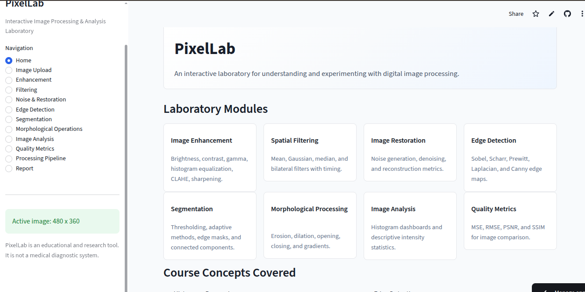

# PixelLab

## Overview

PixelLab is a Streamlit-based educational laboratory for classical digital image processing. It is designed for university coursework and demonstrations, with working algorithms, visualizations, metrics, and downloadable results.

PixelLab is an educational and research tool. It is not a medical diagnostic system.

## Features

- Image upload and built-in sample images
- Brightness, contrast, gamma, histogram equalization, CLAHE, and sharpening
- Mean, Gaussian, median, and bilateral filtering
- Gaussian, salt-and-pepper, and speckle noise generation
- Restoration with MSE, RMSE, PSNR, and SSIM metrics
- Sobel, Scharr, Prewitt, Laplacian, and Canny edge detection
- Thresholding, adaptive thresholding, Otsu, Canny-based segmentation, and connected components
- Morphological erosion, dilation, opening, closing, and gradient
- Histogram and intensity analysis dashboard
- Configurable processing pipeline
- Downloadable processed images, segmentation masks, and HTML reports

## Course Alignment

| Course Concept | PixelLab Feature |
| --- | --- |
| Histogram Processing | Histogram analysis, equalization, CLAHE |
| Spatial Filtering | Mean, Gaussian, median, bilateral filters |
| Noise Reduction | Noise generation and restoration filters |
| Image Restoration | Restoration workflow with quality metrics |
| Edge Detection | Sobel, Scharr, Prewitt, Laplacian, Canny |
| Segmentation | Thresholding, Otsu, adaptive, connected components |
| Morphology | Erosion, dilation, opening, closing, gradient |
| Image Quality | MSE, RMSE, PSNR, SSIM |

## Tech Stack

- Python 3.11
- Streamlit
- OpenCV
- NumPy
- Pillow
- scikit-image
- SciPy
- Plotly
- Matplotlib
- pytest

## Installation

```bash
python -m venv .venv
source .venv/bin/activate
pip install -r requirements.txt
```

## Running Locally

```bash
streamlit run app.py
```

Then open the local URL shown by Streamlit.

## Testing

```bash
pytest
```

The tests cover image utilities, enhancement, filtering, noise generation, restoration metrics, segmentation, and morphology.

## Streamlit Deployment

1. Push this repository to GitHub.
2. Open Streamlit Community Cloud.
3. Create a new app from the repository.
4. Select `app.py` as the main file.
5. Deploy.

No Docker, database, Node.js, or backend server is required.

## Project Structure

```text
.
├── app.py
├── requirements.txt
├── README.md
├── Logbook.txt
├── .streamlit/
│   └── config.toml
├── modules/
│   ├── analysis.py
│   ├── enhancement.py
│   ├── filtering.py
│   ├── metrics.py
│   ├── morphology.py
│   ├── restoration.py
│   ├── segmentation.py
│   └── utils.py
├── assets/
│   └── sample_images/
└── tests/
```

## Screenshots


## Limitations

- PDF report generation is intentionally implemented as a lightweight HTML report for simpler Streamlit Cloud deployment.
- DICOM support is not enabled by default to avoid handling sensitive metadata.
- Large images are resized for responsive interactive processing.

## Future Improvements

- Optional DICOM loader with strict educational metadata filtering
- Interactive before/after slider component
- Pipeline step reordering controls
- Exportable analysis charts
